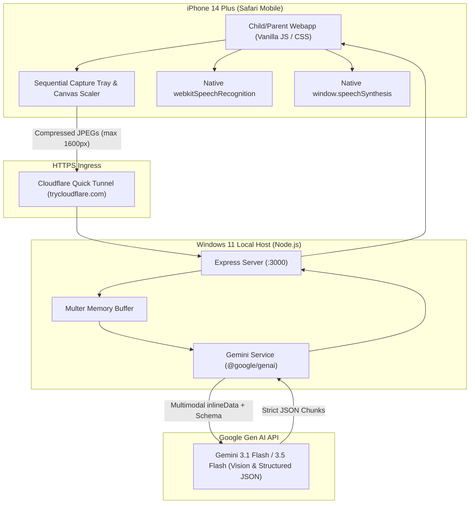
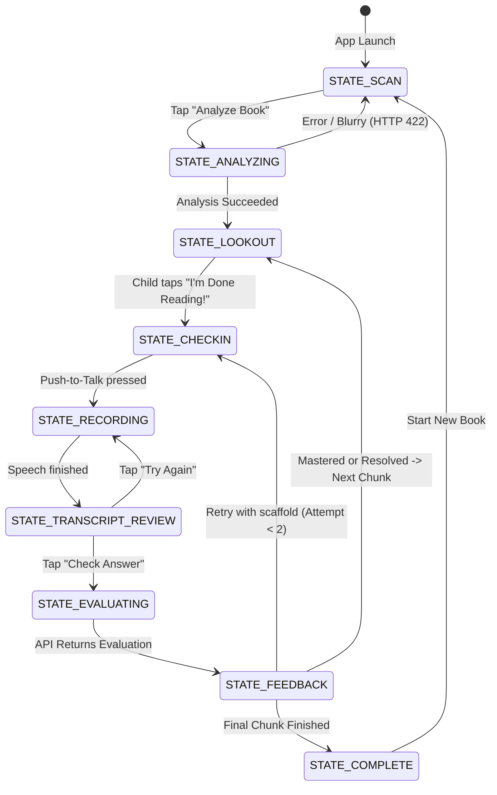

# Architecture & Engineering Blueprint: StoryScout

**Version:** 1.0.0  
**Target Environment:** Local Node.js Express server on Windows 11 host + iPhone 14 Plus (iOS Safari 17/18) client via secure HTTPS tunnel  
**AI Engine:** Google Gemini (`@google/genai` SDK, `gemini-3.1-flash` default; supports `gemini-3.5-flash` / `gemma4`)  
**Target User:** Grade 2 Reader (ages 7–8) + Parent (co-reader / operator)

---

## 1. System Topology & Architectural Overview



---

## 2. Pre-Mortem Risk Register & Architectural Mitigations

Before writing code, the following six core failure modes have been analyzed and designed around:

### Risk 1: Mobile Safari Disables Multi-Capture when `capture` Attribute is Set
* **Root Cause:** In iOS Safari, combining `<input type="file" accept="image/*" capture="environment" multiple>` forces Safari directly into single-shot camera mode. Safari strictly ignores the `multiple` attribute when `capture` is present, closing the camera after exactly one shot.
* **Architectural Solution:**
  1. Implement a **Sequential Page Capture Tray** in the UI.
  2. The parent taps "Snap Page", which launches the camera for one page.
  3. The photo is immediately drawn onto an in-memory HTML5 `<canvas>`, rendered in a thumbnail filmstrip tray with page number labels (`Page 1`, `Page 2`, `Page 3`), and stored in client memory.
  4. Parent can tap "Add Next Page", re-order, or delete/retake blurry shots before committing.
  5. The parent taps a prominent **"Analyze Book (N Pages)"** button when finished.

### Risk 2: High-Resolution Photo Uploads Choking the Upstream Tunnel
* **Root Cause:** iPhone 14 Plus camera captures 12MP to 48MP images (3MB–10MB per image). Uploading 6 uncompressed pages over home Wi-Fi uplink via a reverse tunnel creates 30MB–60MB payloads, causing:
  - Tunnel HTTP 504 Gateway Timeouts.
  - Express `413 Payload Too Large` errors.
  - Long upload latency (15–30s) that destroys child engagement.
* **Architectural Solution:**
  1. **Client-Side Canvas Downscaling:** Before storing/uploading, each captured photo is downsampled via HTML5 canvas to a maximum bounding box of `1600 x 1200` pixels at `image/jpeg` 0.8 quality.
  2. This reduces each page payload from ~6MB down to ~200KB–300KB without any loss of OCR clarity for Gemini Vision.
  3. Total payload for an entire 6-page chapter is under 1.8MB, uploading in < 500ms over local tunnels.

### Risk 3: iOS Safari Speech Recognition Silence Cutoffs
* **Root Cause:** Mobile Safari's `webkitSpeechRecognition` features an aggressive VAD (Voice Activity Detection) silence cutoff (~1.5–2.0s). A 7-year-old child pausing mid-thought will be cut off, resulting in truncated transcripts.
* **Architectural Solution:**
  1. **Push-to-Talk (Hold-or-Toggle):** A prominent microphone button with live interim transcript display (`interimResults = true`).
  2. **Transcript Confirmation & Retry UI:** After listening stops, the recognized text is rendered in a friendly speech bubble ("I heard: *Leo lost his hat*") with two clear buttons:
     - 🚀 **"Check Answer"** (submits to `/api/evaluate-answer`)
     - 🔄 **"Try Again"** (re-opens the microphone if Safari misheard or cut them off).
  3. Parent fallback: Optional tap-to-edit text box in case child speech is unintelligible to Safari STT.

### Risk 4: iOS Web Audio & Web Speech Session Collisions
* **Root Cause:** On iOS WebKit, running `speechSynthesis.speak()` (TTS) and `webkitSpeechRecognition` (STT) simultaneously or without audio clearing locks the device audio session. STT fails with `audio-capture` errors, or TTS is silenced. Furthermore, iOS blocks audio until user interaction.
* **Architectural Solution:**
  1. **Strict Audio State Coordinator (`audio_coordinator.js`):**
     - Before opening STT: explicitly call `window.speechSynthesis.cancel()`.
     - Before triggering TTS: stop any running recognition instances and release the mic stream.
  2. **Gesture-Gated Audio Unlocking:** An initial "Let's Read!" or "Start Chunk" tap fires a zero-volume audio pulse to unlock Safari's Web Audio / Speech subsystem.
  3. Asynchronous voice selection: Listen to `speechSynthesis.onvoiceschanged` with fallback to default system voice if English voices load lazily.

### Risk 5: Google AI Studio Model Access & Vision Schema Edge Cases
* **Root Cause:** The Google AI Studio account has active access to `gemini-3.1-flash`, `gemini-3.5-flash`, and `gemma4` (without `gemini-2.5-flash`). Additionally, if a parent uploads a blurry or non-book image, strict parsing could crash or hallucinate questions.
* **Architectural Solution:**
  1. Standardize on **`gemini-3.1-flash`** as the default production model, parameterized via `process.env.GEMINI_MODEL`, with seamless fallback to `gemini-3.5-flash` or `gemma4`.
  2. Vision Schema Resilience: The `/api/analyze-book` schema includes validation flags:
     ```json
     {
       "is_legible": true,
       "error_message": null,
       "book_type": "fiction",
       "summary": "...",
       "chunks": [...]
     }
     ```
  3. If `is_legible === false`, the API returns HTTP 422 with actionable guidance: *"Page 2 is a bit blurry. Please snap it again in brighter light."*

### Risk 6: Infinite Socratic Scaffolding Frustration Loop
* **Root Cause:** If a child answers incorrectly multiple times and the system endlessly repeats `"needs_scaffold"`, the child loses confidence and disengages.
* **Architectural Solution:**
  1. Track client-side `attempt_count` per chunk (max 2 attempts).
  2. On Attempt 1 failure: Give gentle encouragement and the AI's `scaffold_hint`.
  3. On Attempt 2 failure: Provide the positive resolution, praise effort, explain the concept warmly, and automatically enable the **"Next Pages"** button to preserve forward momentum.

---

## 3. Data Contracts & API Schemas

### 3.1 Endpoint: `POST /api/analyze-book`

* **Request Format:** `multipart/form-data`
  * Field: `images` (array of `image/jpeg` file buffers)
* **Response Status:** `200 OK` or `422 Unprocessable Content`
* **Response JSON Schema (Enforced via Gemini `responseSchema`):**

```json
{
  "type": "OBJECT",
  "properties": {
    "is_legible": { "type": "BOOLEAN", "description": "True if book pages are legible and readable" },
    "error_message": { "type": "STRING", "description": "Explanation if images are unreadable or not a book", "nullable": true },
    "book_type": { "type": "STRING", "enum": ["fiction", "nonfiction"] },
    "summary": { "type": "STRING", "description": "2-sentence high-level summary of the pages" },
    "chunks": {
      "type": "ARRAY",
      "items": {
        "type": "OBJECT",
        "properties": {
          "chunk_id": { "type": "INTEGER" },
          "page_range": { "type": "STRING", "description": "e.g. Pages 1-3" },
          "chunk_type": { "type": "STRING", "enum": ["scene", "page"] },
          "lookout_prompt": { "type": "STRING", "description": "Pre-reading prompt for child focus" },
          "checkin_question": { "type": "STRING", "description": "Grade 2 comprehension question" },
          "target_answer_concept": { "type": "STRING", "description": "Core pedagogical takeaway" },
          "scaffold_hint": { "type": "STRING", "description": "Gentle hint if child struggles" }
        },
        "required": ["chunk_id", "page_range", "chunk_type", "lookout_prompt", "checkin_question", "target_answer_concept", "scaffold_hint"]
      }
    }
  },
  "required": ["is_legible", "book_type", "summary", "chunks"]
}
```

### 3.2 Endpoint: `POST /api/evaluate-answer`

* **Request Format:** `application/json`
```json
{
  "checkin_question": "Why did Leo get upset when his hat blew away?",
  "target_answer_concept": "He was upset because his grandmother made it for him and it was special.",
  "scaffold_hint": "Think about who gave Leo that hat!",
  "child_transcript": "because his grandma made it",
  "attempt_count": 1
}
```
* **Response JSON Schema:**
```json
{
  "type": "OBJECT",
  "properties": {
    "status": { "type": "STRING", "enum": ["mastered", "needs_scaffold", "off_track"] },
    "spoken_feedback": { "type": "STRING", "description": "Under 25 words warm, enthusiastic Grade 2 spoken response" },
    "follow_up_prompt": { "type": "STRING", "description": "Scaffolding nudge if needs_scaffold, otherwise null", "nullable": true }
  },
  "required": ["status", "spoken_feedback"]
}
```

---

## 4. Frontend Finite State Machine (FSM)

The single-page webapp transitions through deterministic states:



---

## 5. File & Directory Layout

Adhering strictly to Single Responsibility and avoiding generic bucket files:

```text
StoryReader/
├── .env.example              # Template: GEMINI_API_KEY, PORT=3000, GEMINI_MODEL
├── .gitignore                # node_modules, .env, uploads
├── package.json              # Minimal dependencies
├── SPEC.md                   # Core product requirements
├── architecture.md           # Living architecture document (this document)
├── server.js                 # Express server bootstrap & route mounting
├── routes/
│   └── book_routes.js        # Multi-part upload handler & route endpoints
├── services/
│   └── gemini_service.js     # @google/genai SDK integration & schemas
├── prompts/
│   ├── book_analysis.js      # Structured Grade 2 prompt template
│   └── answer_evaluation.js  # Socratic feedback prompt template
└── public/
    ├── index.html            # Semantic single-page structure
    ├── style.css             # High-contrast, Grade-2 accessible styling
    └── js/
        ├── camera_tray.js    # Canvas downscaling & photo sequence tray
        ├── audio_manager.js  # Safari TTS / STT coordinator
        └── app.js            # State machine & UI event orchestration
```

---

## 6. HTTPS Tunnel & Local Execution Protocol

To satisfy iOS Safari's Web Speech API security requirement without certificate installations:

1. **Host Boot:**
   ```powershell
   npm install
   npm start
   ```
2. **Zero-Config Cloudflare Tunnel (in a separate terminal):**
   ```powershell
   npx cloudflared tunnel --url http://localhost:3000
   ```
3. Cloudflare outputs a public HTTPS address: `https://<random-id>.trycloudflare.com`.
4. Open this URL in iPhone 14 Plus Safari. Both camera capture and microphone (`webkitSpeechRecognition`) function with zero security blocks.

---

## 7. Grade 2 Pedagogical Rules & Safeguards

1. **Common Core Focus:** Questions are constrained to Grade 2 Reading standards:
   - *Key Details & Central Message:* RL.2.1, RL.2.2, RL.2.3.
   - *Cause & Effect:* Identifying what happened and why characters acted.
2. **Speech Evaluation Tolerance:**
   - 7-8 year old vocabulary includes fillers ("like", "um", "because").
   - ASR transcription artifacts (e.g. slight homophone errors) are ignored if the conceptual kernel is present.
   - Feedback is capped at 25 words to prevent overwhelming auditory processing.
